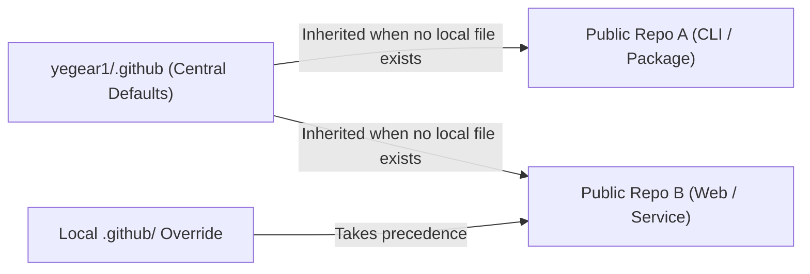

# Default Community Health Files (`yegear1/.github`)

Account-wide default community health files, governance policies, and issue/PR templates inherited across all public repositories maintained by [@yegear1](https://github.com/yegear1).

**[English](README.md)** | **[Português (Brasil)](README.pt-br.md)**

[](LICENSE)

## Overview

GitHub automatically resolves default community health files from a repository named `.github` owned by the user or organization account. By centralizing governance policies and structured templates in [`yegear1/.github`](https://github.com/yegear1/.github), individual project repositories stay free of duplicate boilerplate while enforcing consistent contribution, support, and security standards across the account.

- **Zero Boilerplate Duplication:** Public repositories without local overrides automatically inherit these files in the GitHub UI (Issue Forms, PR checklists, Security tab, and Community Standards checklist).
- **Local Override Precedence:** Any repository that defines its own local `CONTRIBUTING.md`, `SECURITY.md`, or `.github/ISSUE_TEMPLATE/` automatically overrides the corresponding account-wide default.
- **Structured Triage:** YAML-based GitHub Issue Forms enforce required reproduction steps, environment metadata, and pre-flight duplicate checks before submission.

## Architecture



## Inherited Files & Templates

| File / Path | Scope | Description |
| :--- | :--- | :--- |
| [`CODE_OF_CONDUCT.md`](./CODE_OF_CONDUCT.md) | Community Standards | Contributor Covenant v2.1 behavioral expectations and enforcement policy. |
| [`CONTRIBUTING.md`](./CONTRIBUTING.md) | Issue & PR Creation | Contribution workflow, Conventional Commits standard, and clean history rules. |
| [`SECURITY.md`](./SECURITY.md) | Security Tab | Private vulnerability disclosure policy (GitHub Security Advisories & 48h SLA). |
| [`SUPPORT.md`](./SUPPORT.md) | Issue Chooser & Docs | Guidance on where to ask questions, troubleshoot, and seek support without opening bug issues. |
| [`.github/ISSUE_TEMPLATE/bug_report.yml`](./.github/ISSUE_TEMPLATE/bug_report.yml) | Issue Chooser | Structured YAML form requiring reproduction steps, expected behavior, and runtime environment. |
| [`.github/ISSUE_TEMPLATE/feature_request.yml`](./.github/ISSUE_TEMPLATE/feature_request.yml) | Issue Chooser | Structured YAML form capturing problem statements, proposed solutions, and alternatives. |
| [`.github/ISSUE_TEMPLATE/config.yml`](./.github/ISSUE_TEMPLATE/config.yml) | Issue Chooser | Disables blank issues and links directly to private security reporting and support resources. |
| [`.github/pull_request_template.md`](./.github/pull_request_template.md) | Pull Request Creation | Standardized PR summary, change list, and verification checklist (`exit code == 0`). |

## Usage

### Automatic Inheritance

No configuration is required in downstream repositories. Any public repository under `github.com/yegear1/*` automatically inherits the files listed above as long as it does not define a file at the same path.

### Overriding in a Specific Repository

To customize a policy or template for a specific project, create the corresponding file in that repository's root or `.github/` directory:

```bash
# Example: Override only the PR template in a specific repository
mkdir -p .github
cp /path/to/.github/.github/pull_request_template.md .github/pull_request_template.md
```

## Development

```text
.
├── .github/
│   ├── ISSUE_TEMPLATE/
│   │   ├── bug_report.yml
│   │   ├── config.yml
│   │   └── feature_request.yml
│   └── pull_request_template.md
├── CODE_OF_CONDUCT.md
├── CONTRIBUTING.md
├── LICENSE
├── README.md
├── README.pt-br.md
├── SECURITY.md
└── SUPPORT.md
```

Validate YAML syntax and formatting before committing changes:

```bash
python3 -c "import yaml, glob; [yaml.safe_load(open(f)) for f in glob.glob('.github/**/*.yml', recursive=True)]"
git diff --check
```

## License

Released under the [MIT License](LICENSE).
