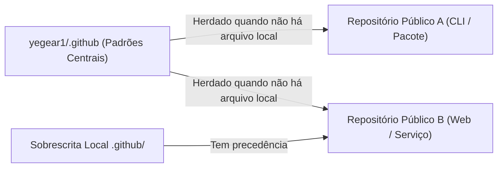

# Arquivos Padrão de Governança e Comunidade (`yegear1/.github`)

Arquivos padrão de saúde da comunidade (*Community Health Files*), políticas de governança e templates de Issues/PRs herdados automaticamente por todos os repositórios públicos mantidos por [@yegear1](https://github.com/yegear1).

**[English](README.md)** | **[Português (Brasil)](README.pt-br.md)**

[](LICENSE)

## Visão Geral

O GitHub resolve automaticamente arquivos padrão de saúde da comunidade a partir de um repositório chamado `.github` pertencente à conta do usuário ou organização. Ao centralizar políticas de governança e formulários estruturados em [`yegear1/.github`](https://github.com/yegear1/.github), os repositórios individuais permanecem limpos e sem arquivos repetidos, garantindo padrões consistentes de contribuição, suporte e segurança em toda a conta.

- **Zero Duplicação de Boilerplate:** Repositórios públicos sem sobrescritas locais herdam automaticamente estes arquivos na interface do GitHub (Issue Forms, checklists de PR, aba Security e checklist de Community Standards).
- **Precedência de Sobrescrita Local:** Qualquer repositório que defina seu próprio `CONTRIBUTING.md`, `SECURITY.md` ou `.github/ISSUE_TEMPLATE/` local substitui automaticamente o padrão global correspondente.
- **Triagem Estruturada:** Formulários de Issue em YAML exigem passos de reprodução, metadados de ambiente e verificação prévia de duplicatas antes do envio.

## Arquitetura



## Arquivos e Templates Herdados

| Arquivo / Caminho | Escopo | Descrição |
| :--- | :--- | :--- |
| [`CODE_OF_CONDUCT.md`](./CODE_OF_CONDUCT.md) | Padrões da Comunidade | Expectativas de comportamento e política de aplicação baseadas no Contributor Covenant v2.1. |
| [`CONTRIBUTING.md`](./CONTRIBUTING.md) | Criação de Issue e PR | Fluxo de contribuição, padrão Conventional Commits e regras de histórico Git limpo. |
| [`SECURITY.md`](./SECURITY.md) | Aba Security | Política de divulgação privada de vulnerabilidades (GitHub Security Advisories e SLA de 48h). |
| [`SUPPORT.md`](./SUPPORT.md) | Seletor de Issues e Docs | Orientações sobre onde tirar dúvidas, diagnosticar problemas e buscar suporte sem abrir issues de bug. |
| [`.github/ISSUE_TEMPLATE/bug_report.yml`](./.github/ISSUE_TEMPLATE/bug_report.yml) | Seletor de Issues | Formulário YAML estruturado exigindo passos de reprodução, comportamento esperado e ambiente de execução. |
| [`.github/ISSUE_TEMPLATE/feature_request.yml`](./.github/ISSUE_TEMPLATE/feature_request.yml) | Seletor de Issues | Formulário YAML estruturado capturando definição do problema, solução proposta e alternativas. |
| [`.github/ISSUE_TEMPLATE/config.yml`](./.github/ISSUE_TEMPLATE/config.yml) | Seletor de Issues | Desabilita issues em branco e adiciona links diretos para relato privado de segurança e suporte. |
| [`.github/pull_request_template.md`](./.github/pull_request_template.md) | Criação de Pull Request | Resumo padronizado de PR, lista de alterações e checklist de verificação (`exit code == 0`). |
| [`.github/FUNDING.yml`](./.github/FUNDING.yml) | Cabeçalho do Repositório | Habilita o botão **Sponsor** nos repositórios públicos (GitHub Sponsors e Ko-fi). |
| [`.github/CODEOWNERS`](./.github/CODEOWNERS) | Revisão de Pull Requests | Define `@yegear1` como proprietário de código padrão para solicitações de revisão. |
| [`profile/README.md`](./profile/README.md) | Perfil da Conta | Visão geral bilíngue de perfil (`README.md` e `README.pt-br.md`) espelhada em `yegear1/yegear1`. |

## Uso

### Herança Automática

Nenhuma configuração é necessária nos repositórios de projetos. Qualquer repositório público sob `github.com/yegear1/*` herda automaticamente os arquivos listados acima desde que não defina um arquivo no mesmo caminho.

### Sobrescrevendo em um Repositório Específico

Para personalizar uma política ou template em um projeto específico, basta criar o arquivo correspondente na raiz ou no diretório `.github/` daquele repositório:

```bash
# Exemplo: Sobrescrever apenas o template de PR em um repositório específico
mkdir -p .github
cp /caminho/para/.github/.github/pull_request_template.md .github/pull_request_template.md
```

## Desenvolvimento

```text
.
├── .github/
│   ├── ISSUE_TEMPLATE/
│   │   ├── bug_report.yml
│   │   ├── config.yml
│   │   └── feature_request.yml
│   ├── CODEOWNERS
│   ├── FUNDING.yml
│   └── pull_request_template.md
├── profile/
│   ├── README.md
│   └── README.pt-br.md
├── CODE_OF_CONDUCT.md
├── CONTRIBUTING.md
├── LICENSE
├── README.md
├── README.pt-br.md
├── SECURITY.md
└── SUPPORT.md
```

Valide a sintaxe YAML e a formatação antes de realizar commits:

```bash
python3 -c "import yaml, glob; [yaml.safe_load(open(f)) for f in glob.glob('.github/**/*.yml', recursive=True)]"
git diff --check
```

## Licença

Distribuído sob a [Licença MIT](LICENSE).
